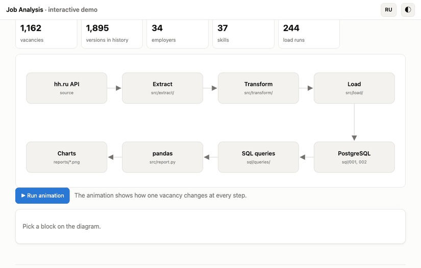
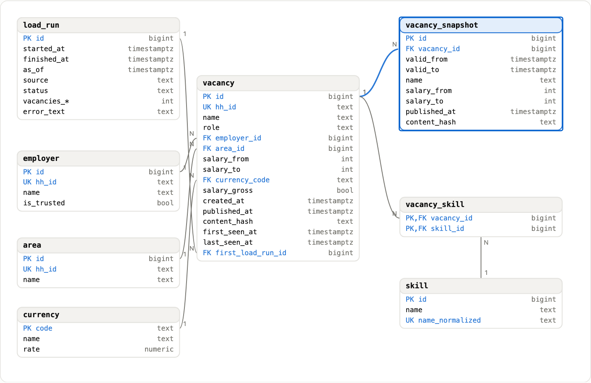
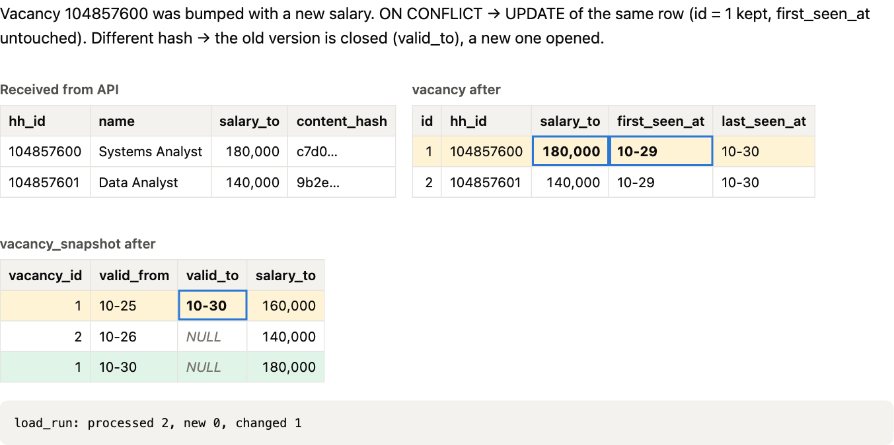
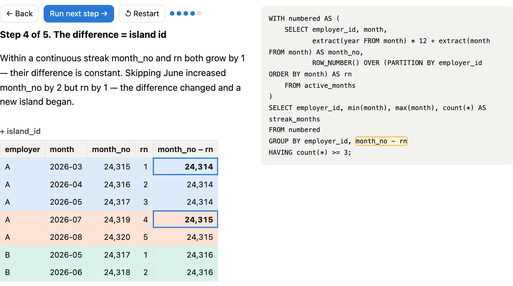
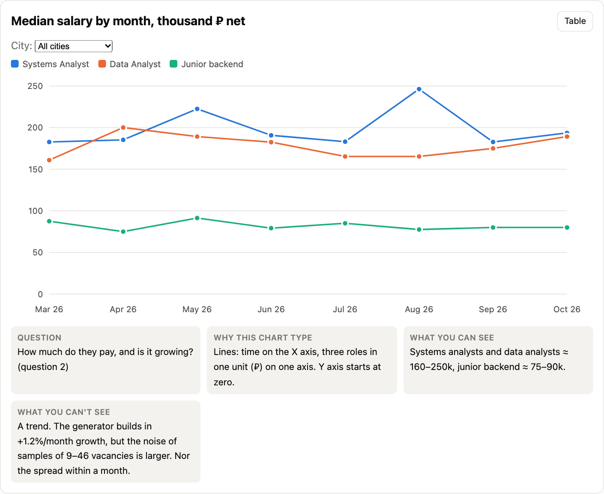
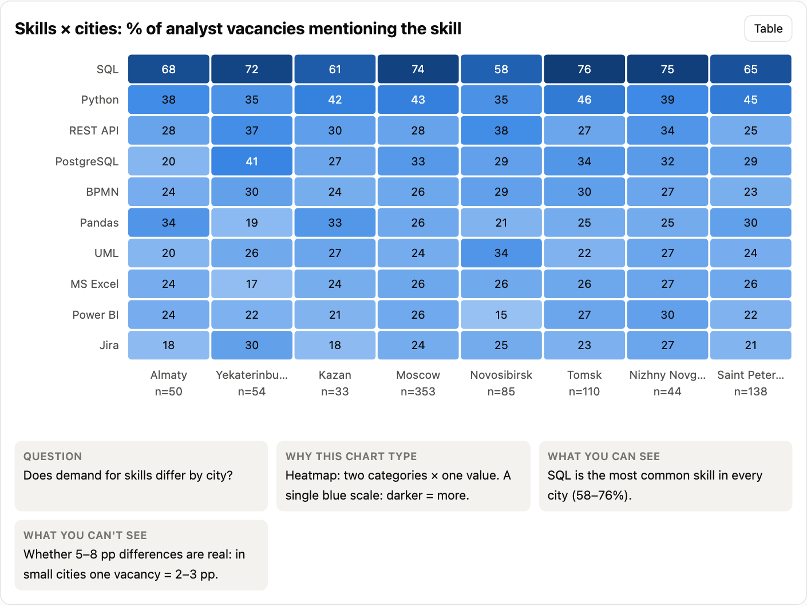
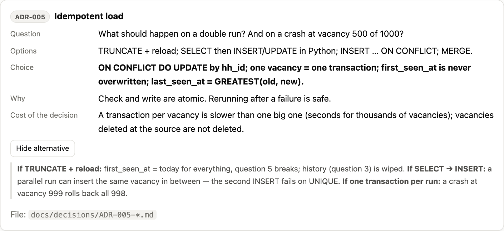

# Job Analysis

[Русская версия](README.md)

I built this project for myself—to look at job openings and figure out which skills are in demand, so I could dedicate more time to them.

<p align="center">
  <a href="https://squidi9qt.github.io/job-analysis/?lang=en"></a>
</p>

<p align="center">
  <a href="https://squidi9qt.github.io/job-analysis/?lang=en"></a>
</p>

## Demo

You don't need to install anything to look at the project. I made a site that shows how everything works: **https://squidi9qt.github.io/job-analysis/?lang=en**. There's a RU / EN switch and a dark theme in the header.

Things to try:

- [the animation](https://squidi9qt.github.io/job-analysis/?lang=en#map): one vacancy goes all the way from the API to a chart;
- [the charts](https://squidi9qt.github.io/job-analysis/?lang=en#charts): hover over them, change the city or role;
- [the database diagram](https://squidi9qt.github.io/job-analysis/?lang=en#model): click a table to see its keys and constraints;
- [the repeated load](https://squidi9qt.github.io/job-analysis/?lang=en#etl): why a second run doesn't create duplicates;
- [SQL step by step](https://squidi9qt.github.io/job-analysis/?lang=en#sql): a tricky query broken down on a small table.

| | |
|---|---|
| **Database diagram**<br>[](https://squidi9qt.github.io/job-analysis/?lang=en#model) | **Repeated load**<br>[](https://squidi9qt.github.io/job-analysis/?lang=en#etl) |
| **SQL step by step**<br>[](https://squidi9qt.github.io/job-analysis/?lang=en#sql) | **Median salary**<br>[](https://squidi9qt.github.io/job-analysis/?lang=en#charts) |
| **Skills by city**<br>[](https://squidi9qt.github.io/job-analysis/?lang=en#charts) | **Decisions with alternatives**<br>[](https://squidi9qt.github.io/job-analysis/?lang=en#decisions) |

## About the data

The hh.ru API returns `403` without an application token, so I couldn't get real data. To keep the project working, I wrote a generator that produces vacancies in the same format as the API responses. For March–October 2026 the database gets 1,162 vacancies from 34 made-up employers. The numbers in the charts describe this test set, not the real market.

The client for the real API is also written and covered by tests with a fake HTTP session, and you switch to it with one line in `.env`. I haven't run it against the live API.

## What I did

- **Requirements.** I started with goals, user stories with acceptance criteria, use cases and a list of open questions instead of code. It's all in [`docs/requirements/`](docs/requirements/) (in Russian).
- **Database.** 8 PostgreSQL tables with CHECK, FK and UNIQUE constraints. Vacancy history is stored as SCD2: if a salary changes, the old version is closed and a new one is opened. Schema in [`sql/001_schema.sql`](sql/001_schema.sql), notes in [`docs/data_model.md`](docs/data_model.md).
- **Loading (ETL).** Pagination, retries on 429 and 5xx with a growing delay, upsert by `hh_id`, a log of runs. Running the load twice in a row creates no duplicates. If it crashes halfway, the next run just loads what's missing. Code in [`src/`](src/).
- **SQL.** 7 queries for 6 business questions (table below). No ORM, plain SQL through psycopg 3.
- **Optimization.** I built a separate database with 300k vacancies and read the plans with EXPLAIN ANALYZE. Query q6 went from 4043 to 143 ms after I replaced a subquery with a window function. Query q5 went from 1300 to 109 ms after two indexes. Details in [`docs/query_plans/`](docs/query_plans/).
- **Decisions.** I wrote 6 ADRs: why these keys, how I convert currencies, why no ORM, and so on. They're in [`docs/decisions/`](docs/decisions/).
- **Report.** 4 matplotlib charts and CSV files in [`reports/`](reports/).
- **API.** One FastAPI endpoint, `/api/summary`.
- **Tests.** 50 pytest tests: data transformation, the HTTP client without network, loading into a real test database, the API.

## Questions answered with SQL

| # | Question | Query | What I used |
|---|----------|-------|-------------|
| 1 | Which skills are asked of analysts most often? | [`q1_top_skills.sql`](sql/queries/q1_top_skills.sql) | CTE, FILTER, HAVING, RANK |
| 2 | How did the median salary change by month? | [`q2_salary_median_by_month.sql`](sql/queries/q2_salary_median_by_month.sql) | ROW_NUMBER, percentile_cont, GROUPING SETS |
| 3 | Who posts the most and how often do they update? | [`q3_employers_activity.sql`](sql/queries/q3_employers_activity.sql) | LAG, IS DISTINCT FROM |
| 4 | Where is salary most often left out? | [`q4_no_salary_by_region.sql`](sql/queries/q4_no_salary_by_region.sql) | ROLLUP, confidence intervals |
| 5 | What appeared in the last 7 days (without duplicates)? | [`q5_new_last_7_days.sql`](sql/queries/q5_new_last_7_days.sql) | anti-join |
| 6 | Which companies hire 3 months in a row or longer? | [`q6_stable_employers.sql`](sql/queries/q6_stable_employers.sql) | gaps-and-islands |

## Stack

Python 3.14, PostgreSQL 16, psycopg 3, requests, pandas, matplotlib, pytest, FastAPI. The demo site is plain HTML, CSS and JS with no libraries.

## Structure

```
src/          code: extract (API and fixtures), transform, load, report, API
sql/          schema, indexes and the business queries
tests/        pytest tests and fixtures
docs/         requirements, ADRs, data model, query plans
reports/      charts and CSV
explainer/    demo site
scripts/      data generator, benchmarks, screenshots
```

## How to run

You need Python 3.14 and PostgreSQL 16. I tested it on a local PostgreSQL. There's a `docker-compose.yml` in the project, but I haven't run it through Docker.

```bash
python3 -m venv .venv && source .venv/bin/activate
pip install -r requirements.txt
cp .env.example .env
createdb vacancies && createdb vacancies_test
```

In `.env` set `DATABASE_URL=postgresql:///vacancies` and `TEST_DATABASE_URL=postgresql:///vacancies_test`, then:

```bash
python -m src.main init-db
python -m src.main backfill --from 2026-03-01 --to 2026-10-30
python -m src.main report
pytest -q
```

Charts and CSV files show up in `reports/`. You can also open the demo locally: `explainer/index.html`.

To start the API (uvicorn is installed separately):

```bash
pip install uvicorn
python -m src.main serve
curl localhost:8000/api/summary
```

```json
{"vacancies": 1162, "employers": 34, "data_as_of": "2026-10-30T23:59:59+03:00",
 "pct_without_salary": 33.0, "top_skills": [{"skill": "SQL", "vacancies": 609}, ...]}
```

## What was hard

- My PostgreSQL runs in the `Asia/Tomsk` time zone, and because of `::date` a vacancy posted at 23:59 Moscow time ended up on the next day. A test and the API broke. Now it's `AT TIME ZONE 'Europe/Moscow'` everywhere.
- In psycopg 3 without autocommit, a nested transaction turns into a SAVEPOINT and never commits. I had to turn on autocommit and open transactions explicitly.
- Searching for "possible duplicates" without a time limit matched almost everything. I limited it to 14 days.

## What I'd do next

- Get an hh.ru token and run the load on real data.
- Check the Docker setup.
- Speed up q2 (median, 0.6 s on 300k) with a materialized view.
- Claude helps with the README file and with the code during difficult moments
