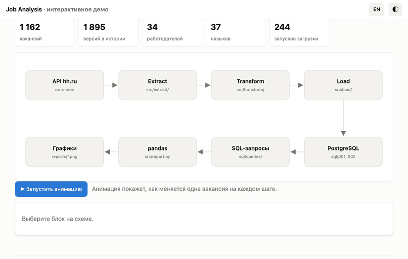
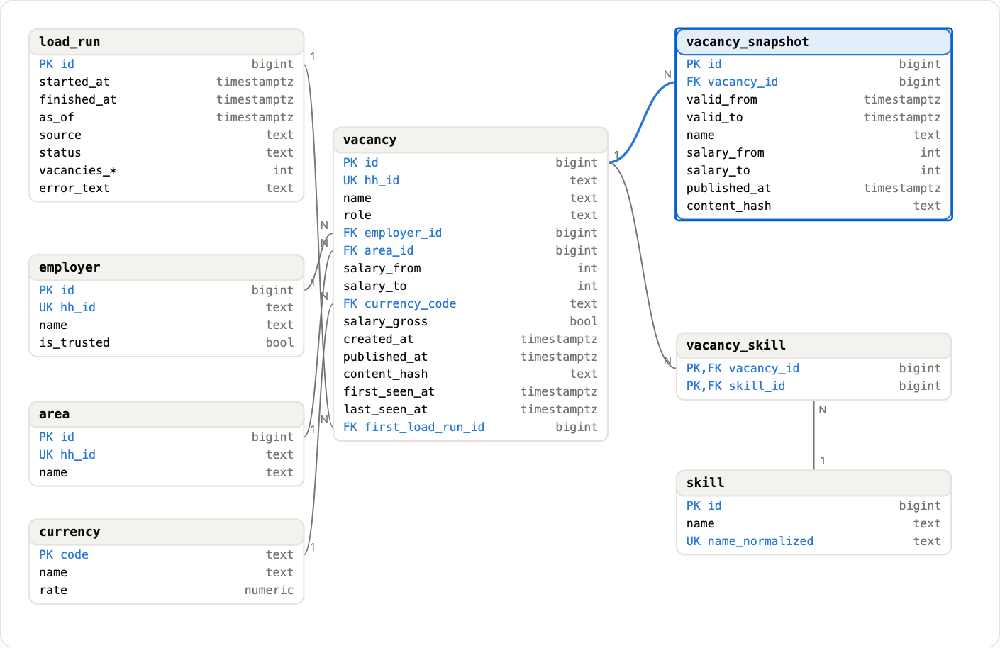
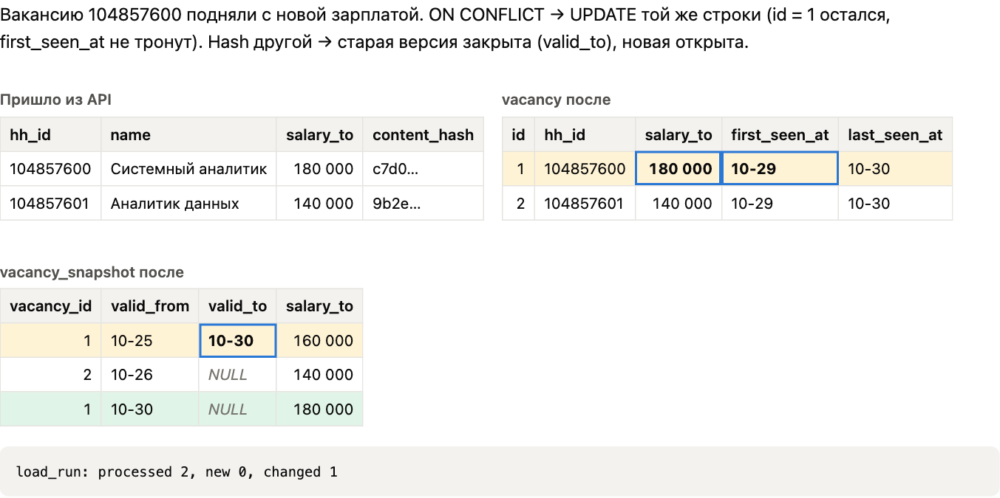
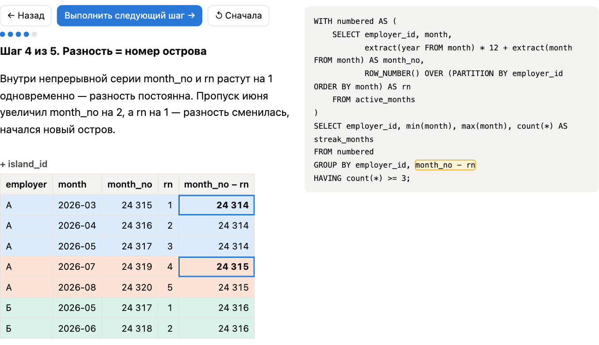
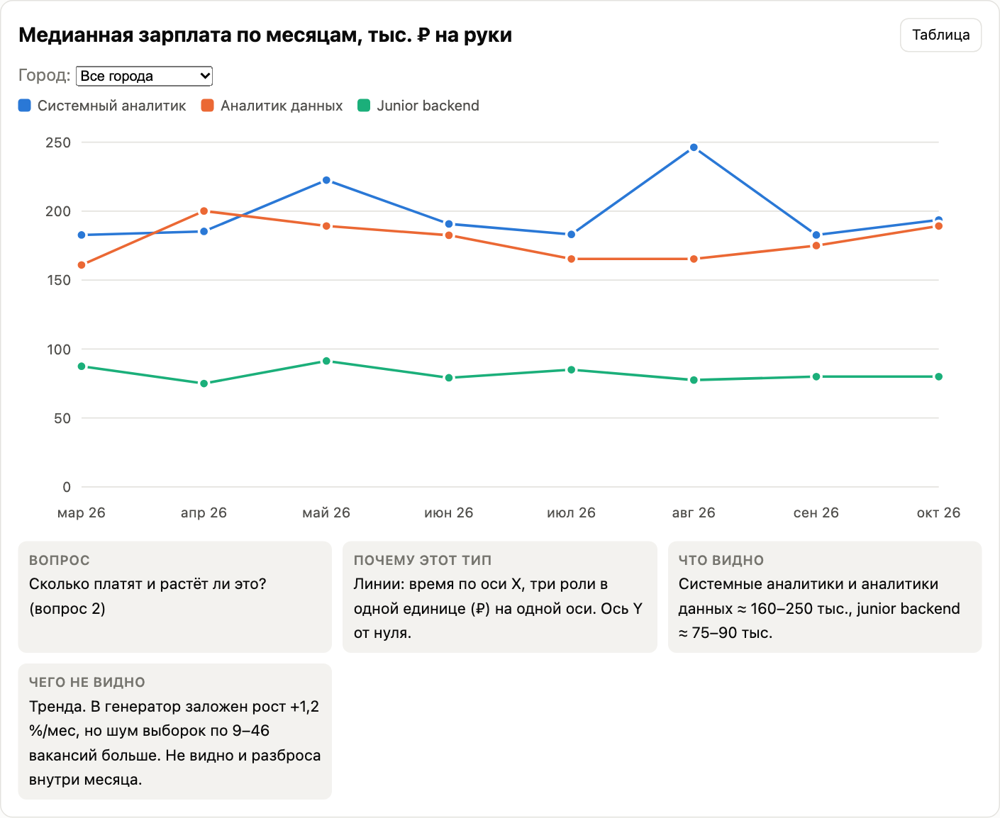
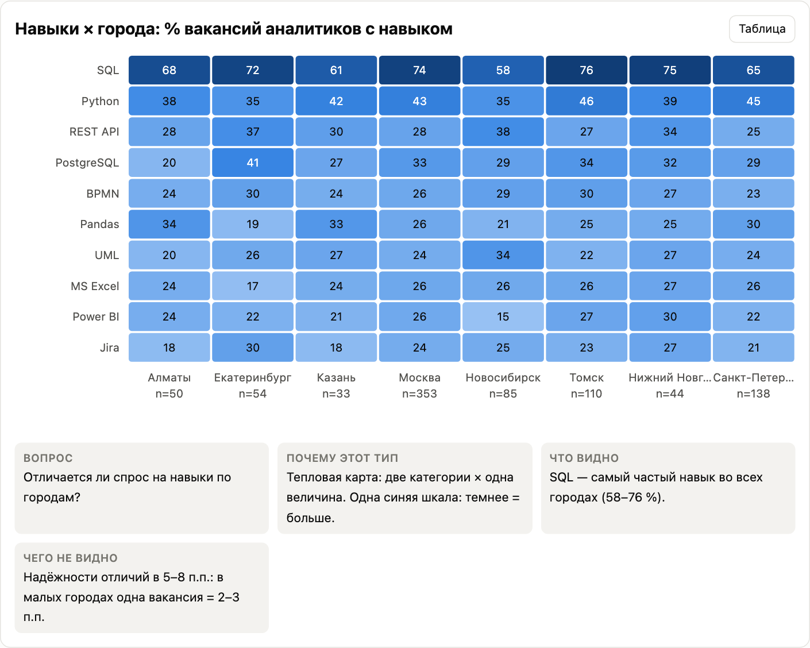
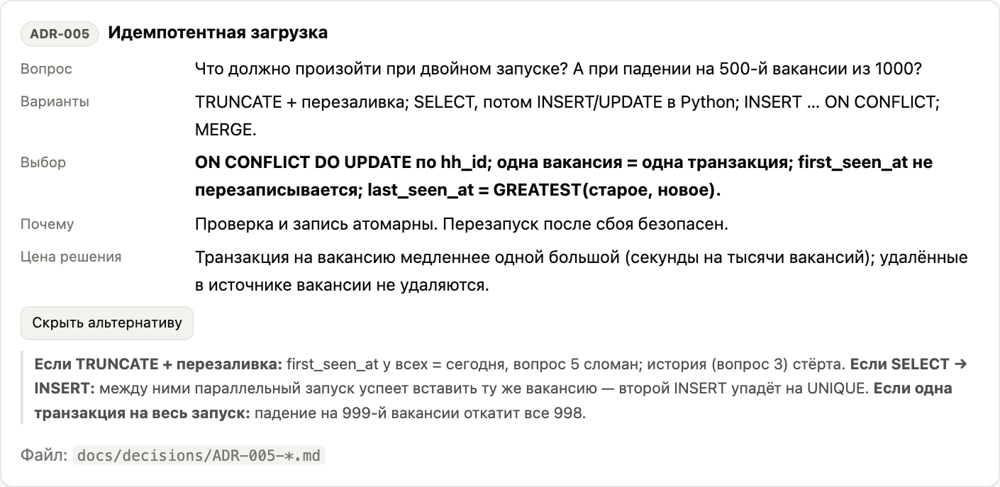

# Job Analysis

[English version](README.en.md)

Проект делал для себя, чтобы посмотреть вакансии и понять какие навыки востребованы и надо уделить им больше времени

<p align="center">
  <a href="https://squidi9qt.github.io/job-analysis/?lang=ru"></a>
</p>

<p align="center">
  <a href="https://squidi9qt.github.io/job-analysis/?lang=ru"></a>
</p>

## Демо

Чтобы посмотреть проект, ничего ставить не нужно. Я сделал сайт, на котором видно, как всё устроено: **https://squidi9qt.github.io/job-analysis/?lang=ru**. В шапке есть переключатель RU / EN и тёмная тема.

Что можно потыкать:

- [анимация](https://squidi9qt.github.io/job-analysis/?lang=ru#map): одна вакансия проходит путь от API до графика;
- [графики](https://squidi9qt.github.io/job-analysis/?lang=ru#charts): можно навести курсор, сменить город и роль;
- [схема базы](https://squidi9qt.github.io/job-analysis/?lang=ru#model): по клику на таблицу видны её ключи и ограничения;
- [повторная загрузка](https://squidi9qt.github.io/job-analysis/?lang=ru#etl): почему второй запуск не создаёт дублей;
- [SQL по шагам](https://squidi9qt.github.io/job-analysis/?lang=ru#sql): сложный запрос разобран на маленькой таблице.

| | |
|---|---|
| **Схема базы**<br>[](https://squidi9qt.github.io/job-analysis/?lang=ru#model) | **Повторная загрузка**<br>[](https://squidi9qt.github.io/job-analysis/?lang=ru#etl) |
| **SQL по шагам**<br>[](https://squidi9qt.github.io/job-analysis/?lang=ru#sql) | **Медиана зарплат**<br>[](https://squidi9qt.github.io/job-analysis/?lang=ru#charts) |
| **Навыки по городам**<br>[](https://squidi9qt.github.io/job-analysis/?lang=ru#charts) | **Решения с альтернативами**<br>[](https://squidi9qt.github.io/job-analysis/?lang=ru#decisions) |

## Про данные

API hh.ru без токена приложения отвечает `403`, поэтому реальные данные я получить не смог. Чтобы проект всё равно работал, я написал генератор, который делает вакансии в том же формате, что и ответы API. За март–октябрь 2026 в базу попадает 1162 вакансии от 34 вымышленных работодателей. Цифры в графиках описывают этот тестовый набор, а не настоящий рынок.

Клиент для настоящего API тоже написан и покрыт тестами на подставной HTTP-сессии, а включается он одной строкой в `.env`. С живым API я его не запускал.

## Что я сделал

- **Требования.** Начал не с кода, а с целей, user stories с критериями приёмки, use case и списка открытых вопросов. Всё лежит в [`docs/requirements/`](docs/requirements/).
- **База данных.** 8 таблиц в PostgreSQL с ограничениями CHECK, FK и UNIQUE. История изменений вакансии хранится по схеме SCD2: если у вакансии поменялась зарплата, старая версия закрывается и открывается новая. Схема в [`sql/001_schema.sql`](sql/001_schema.sql), описание в [`docs/data_model.md`](docs/data_model.md).
- **Загрузка (ETL).** Пагинация, повторы при ответах 429 и 5xx с растущей паузой, upsert по `hh_id` и журнал запусков. Если загрузку запустить два раза подряд, дублей не будет. Если она упадёт посередине, следующий запуск просто догрузит недостающее. Код в [`src/`](src/).
- **SQL.** 7 запросов на 6 бизнес-вопросов (таблица ниже). Без ORM, чистый SQL через psycopg 3.
- **Оптимизация.** Сделал отдельную базу на 300 тыс. вакансий и смотрел планы через EXPLAIN ANALYZE. Запрос q6 ускорился с 4043 до 143 мс, когда я заменил подзапрос оконной функцией. Запрос q5 ускорился с 1300 до 109 мс после двух индексов. Разбор лежит в [`docs/query_plans/`](docs/query_plans/).
- **Решения.** Записал 6 ADR: почему такие ключи, как пересчитываю валюту, почему отказался от ORM и т. д. Они лежат в [`docs/decisions/`](docs/decisions/).
- **Отчёт.** 4 графика matplotlib и CSV в [`reports/`](reports/).
- **API.** Один эндпоинт `/api/summary` на FastAPI.
- **Тесты.** 50 тестов pytest: преобразование данных, HTTP-клиент без сети, загрузка в настоящую тестовую базу и API.

## На какие вопросы отвечает SQL

| # | Вопрос | Запрос | Что использовал |
|---|--------|--------|-----------------|
| 1 | Какие навыки чаще всего просят у аналитиков? | [`q1_top_skills.sql`](sql/queries/q1_top_skills.sql) | CTE, FILTER, HAVING, RANK |
| 2 | Как менялась медианная зарплата по месяцам? | [`q2_salary_median_by_month.sql`](sql/queries/q2_salary_median_by_month.sql) | ROW_NUMBER, percentile_cont, GROUPING SETS |
| 3 | Кто публикует больше всего и как часто обновляет? | [`q3_employers_activity.sql`](sql/queries/q3_employers_activity.sql) | LAG, IS DISTINCT FROM |
| 4 | Где чаще не указывают зарплату? | [`q4_no_salary_by_region.sql`](sql/queries/q4_no_salary_by_region.sql) | ROLLUP, доверительные интервалы |
| 5 | Что появилось за последние 7 дней (без дублей)? | [`q5_new_last_7_days.sql`](sql/queries/q5_new_last_7_days.sql) | anti-join |
| 6 | Какие компании нанимают 3 месяца подряд и дольше? | [`q6_stable_employers.sql`](sql/queries/q6_stable_employers.sql) | gaps-and-islands |

## Стек

Python 3.14, PostgreSQL 16, psycopg 3, requests, pandas, matplotlib, pytest, FastAPI. Демо-сайт написан на HTML,CSS,JS без библиотек.

## Структура

```
src/          код: extract (API и фикстуры), transform, load, отчёт, API
sql/          схема, индексы и запросы на бизнес-вопросы
tests/        тесты pytest и фикстуры
docs/         требования, ADR, модель данных, планы запросов
reports/      графики и CSV
explainer/    демо-сайт
scripts/      генератор данных, замеры, скриншоты
```

## Как запустить

Нужны Python 3.14 и PostgreSQL 16. Я проверял на локальном PostgreSQL. `docker-compose.yml` в проекте есть, но через Docker я не запускал.

```bash
python3 -m venv .venv && source .venv/bin/activate
pip install -r requirements.txt
cp .env.example .env
createdb vacancies && createdb vacancies_test
```

В `.env` поставь `DATABASE_URL=postgresql:///vacancies` и `TEST_DATABASE_URL=postgresql:///vacancies_test`, потом:

```bash
python -m src.main init-db
python -m src.main backfill --from 2026-03-01 --to 2026-10-30
python -m src.main report
pytest -q
```

Графики и CSV появятся в `reports/`. Демо можно открыть локально: файл `explainer/index.html`.

API запускается так (uvicorn ставится отдельно):

```bash
pip install uvicorn
python -m src.main serve
curl localhost:8000/api/summary
```

```json
{"vacancies": 1162, "employers": 34, "data_as_of": "2026-10-30T23:59:59+03:00",
 "pct_without_salary": 33.0, "top_skills": [{"skill": "SQL", "vacancies": 609}, ...]}
```

## Что было сложно

- У моего PostgreSQL часовой пояс `Asia/Tomsk`, и из-за `::date` вакансия, опубликованная в 23:59 по Москве, попадала в следующий день. Упали тест и API. Теперь везде стоит `AT TIME ZONE 'Europe/Moscow'`.
- В psycopg 3 без autocommit вложенная транзакция превращается в SAVEPOINT и ничего не коммитит. Пришлось включить autocommit и открывать транзакции явно.
- Поиск «возможных дублей» без ограничения по времени срабатывал почти на всё. Я ограничил его 14 днями.

## Что бы доделал

- Получить токен hh.ru и прогнать загрузку на реальных данных.
- Проверить запуск через Docker.
- Ускорить q2 (медиана, 0,6 с на 300 тыс.) через материализованное представление.
- Claude помогал с составление README и помогал в сложные моменты с кодом
